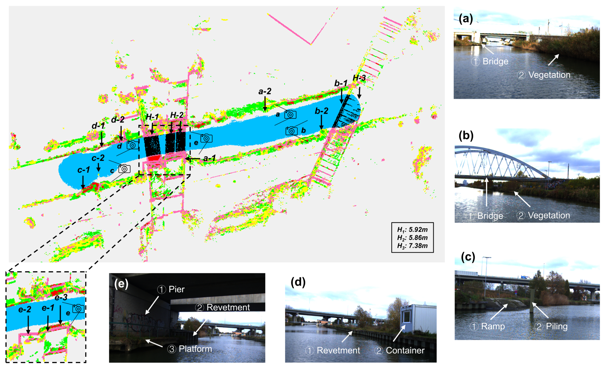
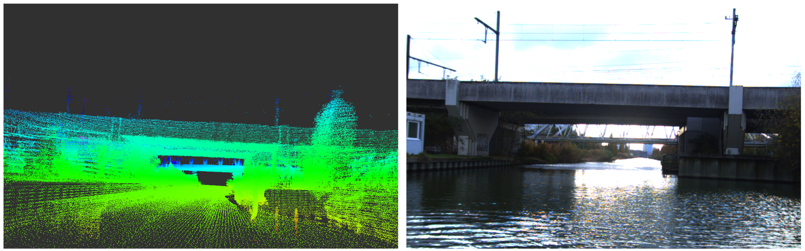

# Inland-LOAM

## Inland-LOAM: Voxel-Based Structural Semantic LiDAR Odometry and Mapping for Inland Waterway Navigation

### News

- **2026-10-17**: 🔓Code released.
- **2026-10-05**: 🚀Conditionally accepted.


## 1. Introduction

Inland-LOAM is a LiDAR odometry and structural semantic mapping system for
inland waterways. It uses geometric features and water surface constraints
for localization, and generates a colored 3D OctoMap and a 2D structural
semantic map. The map represents horizontal and vertical planar surfaces, complex horizontal
and vertical structures, open water, and under-bridge clearance.





### 1.1 Related paper

Zhongbi Luo, Yunjia Wang, Jan Swevers, Peter Slaets, and Herman Bruyninckx.
**Inland-LOAM: Voxel-Based Structural Semantic LiDAR Odometry and Mapping for
Inland Waterway Navigation.** Manuscript under revision.

### 1.2 Dataset

The dataset includes raw LiDAR data collected in Areas A–E and is available
on [OneDrive](https://kuleuven-my.sharepoint.com/:f:/g/personal/zhongbi_luo_kuleuven_be/IgCa6J-httH6R5Sm6yulEYzwAUnMrPP_4IKwaKqs_GaIbC4?e=1LDORC).

## 2. Dependencies

### 2.1 Ubuntu and ROS

Ubuntu **22.04**. First install **ROS 2 Humble Desktop** following the [ROS Installation](https://docs.ros.org/en/humble/Installation/Ubuntu-Install-Debs.html), then install the build tools:

```bash
sudo apt install build-essential cmake git ros-dev-tools
```

The supplied sensor configuration is for the **RoboSense RS-32 Helios**.

### 2.2 PCL, Eigen and Boost

Tested with [PCL 1.12.1](https://pointclouds.org/), [Eigen 3.4.0](https://eigen.tuxfamily.org/) and [Boost 1.74](https://www.boost.org/). Eigen >= 3.3.7 is required.

```bash
sudo apt install libpcl-dev libeigen3-dev libboost-all-dev
```

### 2.3 GTSAM

[GTSAM 4.2](https://github.com/borglab/gtsam/tree/4.2) is available as a ROS Humble binary package:

```bash
sudo apt install ros-humble-gtsam
```

### 2.4 OctoMap and ROS packages

[OctoMap](https://octomap.github.io/) is used for the colored voxel map. Install its ROS interfaces, RViz plugin and the Zstd plugin required by the demo bag:

```bash
sudo apt install ros-humble-octomap ros-humble-octomap-msgs \
  ros-humble-octomap-ros ros-humble-octomap-rviz-plugins \
  ros-humble-pcl-conversions ros-humble-eigen3-cmake-module \
  ros-humble-tf2-geometry-msgs ros-humble-rosidl-default-generators \
  ros-humble-rosbag2 ros-humble-rosbag2-compression-zstd
```

## 3. Build

Clone the repository and build with colcon:

```bash
source /opt/ros/humble/setup.bash
mkdir -p ~/inland_loam_ws/src
cd ~/inland_loam_ws/src
git clone https://github.com/ZhongbiLuo/Inland-LOAM.git inland-loam
cd ~/inland_loam_ws
colcon build --symlink-install --cmake-args -DCMAKE_BUILD_TYPE=Release
source install/local_setup.bash
```

## 4. Demo Run

Download and extract the [demo bag](https://github.com/ZhongbiLuo/Inland-LOAM/releases/download/v1.0.0/inland_loam_area_a_demo.tar),
which contains a short sequence from Area A.

In terminal 1, start Inland-LOAM, map conversion and RViz:

```bash
source /opt/ros/humble/setup.bash
source ~/inland_loam_ws/install/local_setup.bash
ros2 launch inland_loam mapping.launch.py
```

In terminal 2, play the extracted bag:

```bash
source /opt/ros/humble/setup.bash
ros2 bag play /path/to/extracted_demo --rate 1.0
```

Replace `/path/to/extracted_demo` with the extracted bag directory containing
`metadata.yaml`. Wait for RViz to open before playing.

RViz shows the raw LiDAR points, 3D map, trajectory, and structural semantic
map at **0.6 opacity**. See [running your own data](docs/RUNNING.md)
and the [configuration reference](docs/CONFIGURATION.md) for further details.
Loop closure is disabled in the supplied configuration.

## 5. License

The repository uses the [BSD 3-Clause License](LICENSE). The `mapconversion`
and `mapconversion_msgs` packages retain their upstream MIT licenses.
See [third-party notices](THIRD_PARTY_NOTICES.md) for component attribution.

We thank the authors of [LeGO-LOAM](https://github.com/RobustFieldAutonomyLab/LeGO-LOAM),
its ROS 2 ports, and
[Map-Conversion-3D-Voxel-Map-to-2D-Occupancy-Map](https://github.com/LTU-RAI/Map-Conversion-3D-Voxel-Map-to-2D-Occupancy-Map)
for their work.
